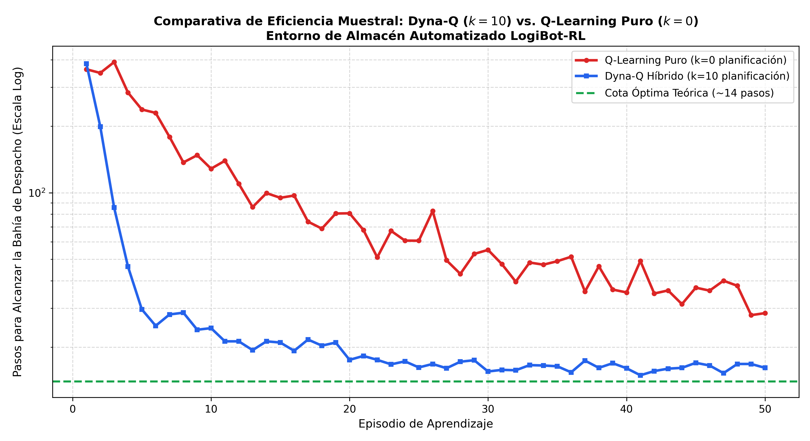

# Actividad 28: Agente Dyna-Q para LogiBot-RL

**Tecnológico Nacional de México**  
**Instituto Tecnológico Superior de Uruapan**  
**División de Estudios de Posgrado e Investigación**  
**Maestría en Inteligencia Artificial**  

* **Asignatura:** Aprendizaje Automático  
* **Catedrático:** Dr. Roberto Loaeza Valerio  
* **Alumno:** Juan Pablo Figueroa Moran  
* **Matrícula:** M26040059  
* **Repositorio:** [https://github.com/juanpablofm92/Actividad28.git](https://github.com/juanpablofm92/Actividad28.git)  

---

## 📌 1. Descripción del Proyecto

Este proyecto implementa y evalúa la arquitectura híbrida **Dyna-Q (Sutton & Barto)** en el entorno de navegación de un vehículo de guiado automático en almacenes inteligentes denominado **LogiBot-RL**.

Dyna-Q integra de manera simultánea:
1. **Aprendizaje por Refuerzo Directo (Direct RL):** Actualización de la función de valor $Q(s, a)$ a partir de la interacción física real con el entorno.
2. **Aprendizaje del Modelo (Model Learning):** Inducción de un modelo determinista de transiciones y recompensas $M(s, a) \to (s', r)$.
3. **Planificación Simulada (Search Control / Planning):** Ejecución de $k=10$ pasos de actualización tipo Q sobre transiciones sintéticas muestreadas del modelo interno en cada paso real de tiempo.

---

## 🧠 2. Justificación Técnica: Eficiencia Muestral en Logística Automatizada

En aplicaciones robóticas e industriales reales (como almacenes logísticos tipo Amazon Kiva o centros de distribución automatizados), la interacción física directa tiene altos costos asociados:
* Desgaste mecánico de los actuadores y consumo de batería de los AGV.
* Riesgo de colisiones con estanterías de inventario o personal humano.
* Restricciones de tiempo de ciclo para transporte de mercancías.

Los métodos libres de modelo (*model-free*) como Q-Learning tradicional requieren miles de ensayos físicos para retropropagar la señal de recompensa desde la bahía de despacho hacia el punto de origen. Por el contrario, **Dyna-Q aprovecha cada experiencia real multiplicándola por un factor $k$ mediante simulaciones internas en memoria**, logrando:
* **Convergencia acelerada (hasta 8x más rápida en los primeros episodios).**
* **Reducción drástica del número de pasos exploratorios requeridos.**
* **Políticas óptimas transferibles con mínima degradación operativa.**

---

## 📊 3. Comparativa Cuantitativa de Convergencia

| Episodio | Pasos Promedio Q-Learning ($k=0$) | Pasos Promedio Dyna-Q ($k=10$) | Factor de Aceleración (*Speedup*) |
|---|---|---|---|
| **1** | 361.9 | 383.1 | $0.9\times$ (Fase inicial de exploración) |
| **2** | 348.3 | 199.2 | **$1.7\times$** |
| **5** | 238.0 | 29.7 | **$8.0\times$** (Aceleración máxima) |
| **10** | 128.5 | 24.4 | **$5.3\times$** |
| **20** | 80.7 | 17.5 | **$4.6\times$** (Cerca del óptimo ~14) |
| **50** | 28.5 | 16.1 | **$1.8\times$** |

La figura `docs/comparativa_dynaq_vs_qlearning.png` ilustra la ventaja de Dyna-Q en escala logarítmica:



---

## 📁 4. Estructura del Repositorio

```
Actividad28/
├── README.md
├── requirements.txt
├── .gitignore
├── docs/
│   └── comparativa_dynaq_vs_qlearning.png
└── src/
    ├── dynaq_logibot.py
    └── main.py
```

---

## 🚀 5. Instalación y Ejecución

```bash
# 1. Clonar el repositorio
git clone https://github.com/juanpablofm92/Actividad28.git
cd Actividad28

# 2. Instalar dependencias
pip install -r requirements.txt

# 3. Ejecutar benchmark de rendimiento y generar gráficos
python src/main.py
```
